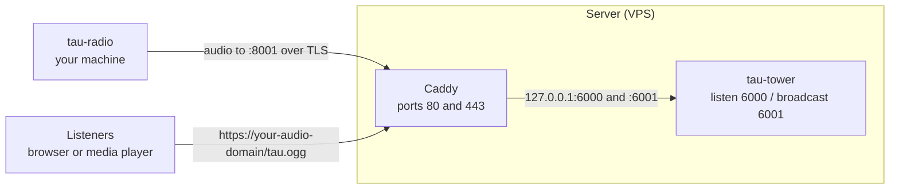

# Self-host Tau on a VPS

This guide deploys `tau-tower` to a VPS behind a Caddy reverse proxy with
automatic HTTPS, then broadcasts live audio to it from your machine with
`tau-radio`. At the end, listeners open `https://<your-audio-domain>/tau.ogg`
over HTTPS, and `tau-tower` runs as a service that survives reboots. To try Tau
on one machine first, see [Try Tau locally](local-test.md).

## Architecture

Tau is two programs, plus a reverse proxy:

- **`tau-radio`** runs on your machine, captures an audio device, and sends the
  stream to the server.
- **`tau-tower`** runs on the VPS, receives the stream, and serves it to
  listeners.
- **Caddy** runs in front of `tau-tower` on the same server, terminating HTTPS
  and forwarding to its local ports.



## Ports

`tau-tower` uses two local ports: `listen_port` (`6000`) receives audio from
`tau-radio`, and `broadcast_port` (`6001`) serves it to listeners. Caddy exposes
both publicly, so `tau-radio` connects over TLS to port `8001` while listeners
use the plain HTTPS domain. Note that `listen_port` is where the server receives
the broadcast, not where listeners connect.

## Prerequisites

- A Linux VPS from any provider, such as AWS or DigitalOcean, with at least 1
  vCPU and 2 GB of RAM.
- A domain you control, used below as `<your-audio-domain>`.
- SSH access to the server as a user with `sudo`.
- A broadcaster machine with an audio device to stream (`BlackHole 2ch` on
  macOS, `pipewire` on Linux).

Smaller instances, including the base DigitalOcean droplet, may not have enough
RAM to compile `tau-tower`. If yours does not, build on a larger machine and copy
the binary to the server, or cross-compile for the server's architecture with
`cargo build --release --target x86_64-unknown-linux-gnu`.

Replace every `<placeholder>` in angle brackets, including the brackets, before
you run a command or save a file.

## Step 1: Point your domain at the server

Create an A record for your audio subdomain pointing at the server's IP address.
Verify with `dig +short <your-audio-domain>`, which should print the server IP,
before continuing.

## Step 2: Open the firewall

Open these inbound TCP ports on the server: `22` for SSH, `80` and `443` for
Caddy, and `8001` for the `tau-radio` source connection. Keep `tau-tower`'s local
ports `6000` and `6001` closed to the public, since Caddy reaches them over
`127.0.0.1`.

## Step 3: Install tau-tower on the server

First, install the tools that `cargo install` needs:

- `rustc` and `cargo`
- `git`, because the install command reads from a git repository
- `cc`, or another C compiler available as the system C compiler
- `make`
- `perl`, because `tau-tower` builds vendored OpenSSL from source

Then install `tau-tower`:

```bash
cargo install --git https://github.com/tau-org/tau-tower
```

Verify the install:

```bash
tau-tower --version
```

If the shell cannot find `tau-tower`, load Cargo's environment and try again:

```bash
. "$HOME/.cargo/env"
tau-tower --version
```

## Step 4: Configure tau-tower

Create `$HOME/.config/tau/tower.toml`:

```toml
username = "<source-username>"
password = "<source-password>"

listen_port = 6000
broadcast_port = 6001
broadcast_endpoint = "tau.ogg"

cors_allow_list = ["*"]
```

Set your own `username` and `password`, and leave the ports as shown, since Caddy
forwards to them in the next step. These credentials only pair `tau-radio` with
`tau-tower`; they are not a security boundary, so do not reuse a sensitive
password. Restart `tau-tower` after any change to this file. While testing,
`cors_allow_list = ["*"]` is fine; later, restrict it to the origins that embed
the stream.

## Step 5: Put tau-tower behind Caddy with HTTPS

Put `tau-tower` behind Caddy so listeners reach it over HTTPS with an automatic
certificate. Follow [Put tau-tower behind Caddy](proxy-setup.md), then come back
for Step 6.

## Step 6: Run tau-tower as a service

Started from a shell, `tau-tower` stops when the shell closes. Run it under a
service manager instead, so it starts on boot and restarts if it exits. The steps
below use systemd, the default on most Linux distributions. Without systemd, use
your init system or run `tau-tower` in a container with a restart policy like `--restart unless-stopped`.

Install the binary system-wide and create a service user:

```bash
sudo install -m 0755 "$(command -v tau-tower)" /usr/local/bin/tau-tower
sudo useradd --system --home /var/lib/tau --create-home --shell /usr/sbin/nologin tau
```

Copy your config where the service user can read it:

```bash
sudo install -d -o tau -g tau /var/lib/tau/.config/tau
sudo cp "$HOME/.config/tau/tower.toml" /var/lib/tau/.config/tau/tower.toml
sudo chown tau:tau /var/lib/tau/.config/tau/tower.toml
sudo chmod 600 /var/lib/tau/.config/tau/tower.toml
```

Create `/etc/systemd/system/tau-tower.service`:

```ini
[Unit]
Description=Tau Tower audio stream server
After=network-online.target
Wants=network-online.target

[Service]
User=tau
Group=tau
Environment=HOME=/var/lib/tau
WorkingDirectory=/var/lib/tau
ExecStart=/usr/local/bin/tau-tower
Restart=on-failure
RestartSec=2

[Install]
WantedBy=multi-user.target
```

Enable and start it:

```bash
sudo systemctl daemon-reload
sudo systemctl enable --now tau-tower
```

The service keeps `tau-tower` running. You still start `tau-radio` on your
machine to broadcast.

## Step 7: Install tau-radio on your machine

On your broadcaster machine, install `tau-radio` and its audio dependencies by
following the [tau-radio installation guide](https://github.com/tau-org/tau-radio#install-tau-radio).

## Step 8: Set up your audio device

`tau-radio` streams whatever plays into the input device you name as
`audio_interface`. Set up that device and find its exact name with
[Choose your audio device](https://github.com/tau-org/tau-radio#choose-your-audio-device)
in the tau-radio README.

## Step 9: Configure tau-radio

Create `$HOME/.config/tau/config.toml`:

```toml
username = "<source-username>"
password = "<source-password>"

url = "<your-audio-domain>"
upstream_port = 8001

audio_interface = "<audio-device>"
tls = true
```

Use the same username and password as `tower.toml`, and set `audio_interface` to
the device name from the previous step. Keep `url` to the bare domain, with no
`https://` or `/tau.ogg`.

## Step 10: Broadcast and verify the stream

Start `tau-radio` on the broadcaster machine:

```bash
tau-radio
```

The startup output names the audio device it is capturing and the server it is
sending to. Then open `https://<your-audio-domain>/tau.ogg` in a browser or media
player. If it plays but is silent, `tau-radio` is not capturing audio; see
[the Troubleshooting section below](#troubleshooting).

## Add a terminal stream (optional)

To pair the audio with a live Asciinema terminal stream, see
[Add Asciinema](asciinema_setup.md).

## Configuration reference

Every `tower.toml` and `config.toml` field is documented in the
[configuration reference](config-reference.md).

## Troubleshooting

### Install and build

If `tau-radio` or `tau-tower` says `command not found`, add Cargo's binary
directory to the shell path:

```bash
echo 'export PATH="$HOME/.cargo/bin:$PATH"' >> "$HOME/.zshrc"
source "$HOME/.zshrc"
```

If `cargo install` looks stuck at `openssl-sys(build)`, it is compiling OpenSSL
from source. Leave it running while the CPU stays busy.

### Caddy and HTTPS

If Caddy returns `502 Bad Gateway` for the listener URL, start or restart
`tau-tower` on the server.

If Caddy says `Client sent an HTTP request to an HTTPS server`, open
`https://<your-audio-domain>/tau.ogg`, not `http://<your-audio-domain>:8001`.
That port carries the source connection from `tau-radio`, not listener traffic.

### Audio and playback

If the listener URL opens but has no sound, confirm `tau-radio` is running and
that audio is routed into the device named by `audio_interface`. If it reports
that the device does not match anything on your system, the name is wrong. 
Find and use the exact audio device name.

### Config

If a config file has wrong values, recreate it from the prompts with
`tau-tower --reset-config` on the server or `tau-radio --reset-config` on the
broadcaster machine.
